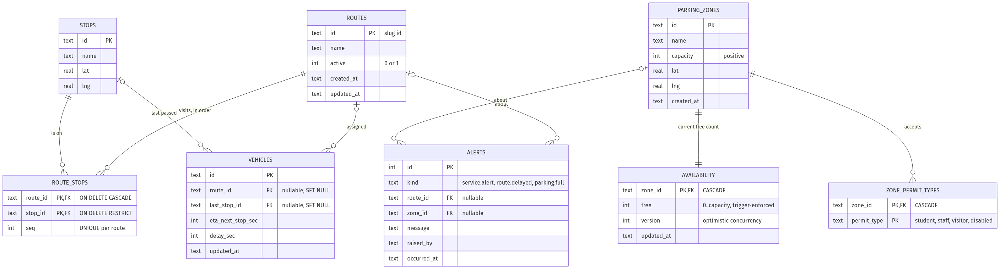

# A3 — Data and Query Design · Team 11 Transport & Parking

**Course:** 1305308 Platform Development · **Assignment 3:** Database Design (Group)  
**Team 11 — Campus Transport & Parking** · Kanthi Phoosorn (6731503004)  
**Database:** Cloudflare D1 `team11-transport-parking` (remote, region APAC)  
**API:** https://team11-transport-parking.kanthiphs.workers.dev  
**Source:** `team11-transport-parking-api/` — `migrations/`, `src/index.ts`, `scripts/api-demo.sh`  
**Evidence run:** `20260915T083739Z` (UTC), full transcript in `evidence/api-demo-20260915T083739Z.txt`  

---

## 1. What the data has to support

The mini project (PRD Phase 1) answers one question on one screen: *"what's the next shuttle on my route, and where can I park near where I'm going?"* Four actors write or read data — student commuter, staff/permit holder, parking operator, shuttle dispatcher — and the PRD fixes three things the database must get right:

1. **One invariant.** `0 ≤ Availability.free ≤ ParkingZone.capacity` (PRD 3.2).
2. **One race.** Two operators PATCH the same zone at the same instant; neither update may be silently lost (PRD 3.2).
3. **One privacy rule.** A *Journey* is computed for the request and never stored, so no per-person movement history exists (PRD 3.2).

Everything in this document is shaped by those three lines.

## 2. Why Cloudflare D1

The PRD's Phase 5 already picked "SQLite in dev, a relational store in prod" because the entities are relational and one SQL transaction solves the race. D1 *is* SQLite — served from Cloudflare's edge next to the Worker that runs our API (Assignments 2 and 5 already run there). So the choice was mostly about confirming that the other two options didn't buy anything the PRD asks for.

| Need (from the PRD) | Cloudflare D1 | Supabase (Postgres) | Firebase Firestore |
|---|---|---|---|
| Relational entities with real foreign keys (route ↔ stop, zone ↔ availability) | Yes — SQLite FKs, `CASCADE` / `RESTRICT` | Yes | No joins; references are manual, integrity is app code |
| Enforce `free ≤ capacity` *in the database* | Trigger (shown in §4) | CHECK / trigger | Only via security rules or app code |
| Solve the concurrent-PATCH race | One `UPDATE … WHERE version = ?`; D1 batch = transaction | Same, plus row locks | Transactions exist but on documents, not on a relational condition |
| Same platform as the API (no cross-service hop, no secrets to manage for a DB URL) | Yes — a binding on the Worker | No — separate service, connection pooling, latency | No — separate SDK and auth |
| Zero budget for a one-term project | Free tier: 5 GB, 5 M reads/day | Free tier, but projects pause after inactivity | Free tier |
| Migrations as versioned files in git | `wrangler d1 migrations` (used in §5) | Supabase CLI migrations | No schema, so no migrations |
| Fits the PRD's "SQLite → relational" plan | Exactly | Yes (different engine) | No |

What we give up, honestly: D1 is single-writer per database and tops out at 10 GB; there is no Postgres-only feature set (no `LISTEN/NOTIFY`, no PostGIS). For four parking zones and three shuttle routes on one campus, none of that is a constraint we would hit in the life of this project. If it ever became one, the schema below is plain SQL and moves to Postgres without redesign.

## 3. ER diagram



Source: `evidence/erd.mmd` (Mermaid `erDiagram`; renders on GitHub).

Reading it: `ROUTE_STOPS` is the ordered many-to-many that replaces the PRD's `Route.stopIds[]` / `Stop.routeIds[]`; `ZONE_PERMIT_TYPES` replaces `ParkingZone.permitTypes[]`; `AVAILABILITY` is split from `PARKING_ZONES` because it has a different owner (the operator) and a different write rate; `ALERTS` records the events other teams consume. There is deliberately **no `JOURNEYS` table**.

## 4. Schema and the decisions behind it

Full DDL: `migrations/0001_schema.sql` (8 tables, 2 triggers, 2 indexes). The parts that carry the design:

| Decision | Where | Why |
|---|---|---|
| IDs are short slugs (`R1`, `S-LIB`, `Z-GATE`) with a `CHECK (id GLOB '[A-Za-z0-9_-]*' AND length BETWEEN 1 AND 40)` | every entity table | Matches the PRD 4.3 contract regex, reads well in URLs and in events other teams receive |
| Array fields become join tables | `route_stops(route_id, stop_id, seq)`, `zone_permit_types` | Third normal form; "which routes serve this stop?" is one query, not a scan through JSON |
| `route_stops.seq` with `UNIQUE (route_id, seq)` | join table | A route's stop order is data, not client convention |
| `availability` is its own table, 1:1 with `parking_zones` | parking side | Ownership boundary from PRD 3.1 — only the operator writes it |
| `availability.version INTEGER` | parking side | Optimistic concurrency token; the `UPDATE` only applies if the caller's version is still current |
| **Trigger** `trg_availability_free_le_capacity_*` raising `'free exceeds zone capacity'` | parking side | SQLite `CHECK` can't read another table; the trigger makes the database refuse the write even if the API is bypassed |
| `ON DELETE CASCADE` on `route_stops.route_id`, `availability`, `zone_permit_types`; `ON DELETE RESTRICT` on `route_stops.stop_id`; `SET NULL` on `vehicles.route_id` | FKs | A deleted route takes its own stop list with it; a stop that routes still visit cannot be deleted; a vehicle whose route disappears becomes unassigned, not orphaned |
| `permit_type` is a constrained string, not a table | `zone_permit_types` | Permits belong to the Identity team (PRD 3.1); we reference the type, we never store permit holders |
| No `journeys` table | — | PRD 3.2 privacy by design; `GET /v1/journeys` returns `"stored": false` |

The trigger, verbatim:

```sql
CREATE TRIGGER trg_availability_free_le_capacity_upd
BEFORE UPDATE OF free ON availability
BEGIN
  SELECT RAISE(ABORT, 'free exceeds zone capacity')
  WHERE NEW.free > (SELECT capacity FROM parking_zones WHERE id = NEW.zone_id);
END;
```

## 5. Migration and deployment to the remote database

Schema and seed are two versioned files applied with Wrangler's migration tool, so the remote database's state is reproducible from git.

```
migrations/0001_schema.sql   tables, FKs, triggers, indexes
migrations/0002_seed.sql     5 stops, 3 routes (1 inactive), 4 vehicles, 4 zones, availability

$ npx wrangler d1 migrations apply team11-transport-parking --remote
│ 0001_schema.sql │ ✅ │
│ 0002_seed.sql   │ ✅ │

$ npx wrangler d1 migrations list team11-transport-parking --remote
✅ No migrations to apply!
```

Proof from the remote database (run `20260915T083739Z`) — eight tables, the two triggers on `availability`, and no journeys table:

```
table_name        | triggers        routes | stops | route_stops | vehicles | zones | zone_permit_types | availability | alerts
alerts            | 0               3      | 5     | 10          | 4        | 4     | 7                 | 4            | 0
availability      | 2
parking_zones     | 0
route_stops       | 0
routes            | 0
stops             | 0
vehicles          | 0
zone_permit_types | 0
```

The same migrations applied to a local D1 first; the trigger (`free exceeds zone capacity`), the `RESTRICT` (`FOREIGN KEY constraint failed` on deleting `S-LIB`) and the cascade (deleting `R9` left 0 `route_stops` rows) were all exercised at the SQL level before anything was deployed.

## 6. API

Deployed Worker: `https://team11-transport-parking.kanthiphs.workers.dev`. All routes are under `/v1`; error model `400 / 401 / 403 / 404 / 409 / 422` as in PRD 4.3. Operator and dispatcher authenticate with a bearer token (`OPERATOR_TOKEN`, `DISPATCHER_TOKEN`, stored as Worker secrets).

| PRD | Method & path | Who | Notes |
|---|---|---|---|
| API-1 | `GET /v1/routes` (`?active=all`) | public | with `stop_count` |
| API-2 | `GET /v1/routes/:id`, `GET /v1/routes/:id/stops` | public | ordered by `seq` |
| — | `POST /v1/routes`, `PUT /v1/routes/:id`, `DELETE /v1/routes/:id` | dispatcher | route + ordered stops written in **one D1 batch** (transaction) |
| — | `GET /v1/stops`, `GET /v1/stops/:id` | public | with `route_ids` |
| — | `POST /v1/stops`, `PUT /v1/stops/:id`, `DELETE /v1/stops/:id` | dispatcher | delete → **409** if still on a route |
| API-3 | `GET /v1/vehicles?routeId=`, `GET /v1/vehicles/:id` | public | |
| — | `POST /v1/vehicles`, `PATCH /v1/vehicles/:id`, `DELETE /v1/vehicles/:id` | dispatcher | `delaySec ≥ 300` raises `route.delayed` |
| API-4 | `GET /v1/parking?permitType=`, `GET /v1/parking/:id` | public | zone + availability + permit types |
| API-5 | `PATCH /v1/parking/:id` `{free, version}` | operator | **409** on stale version; `free → 0` raises `parking.full` |
| — | `POST /v1/parking`, `PUT /v1/parking/:id`, `DELETE /v1/parking/:id` | operator | create writes zone + availability + permits atomically |
| API-6 | `POST /v1/alerts`, `GET /v1/alerts` | operator / dispatcher, public | |
| API-7 | `GET /v1/journeys?origin=&dest=&permitType=` | public | computed, `"stored": false` |

That is full create / read / update / delete on routes, stops, vehicles and parking zones, plus the two PRD-specific writes (availability, alerts).

## 7. Example requests and responses

All captured from the deployed API on `2026-09-15` (UTC). Bearer tokens are elided.

### 7.1 Read the shuttle network (API-1, API-2, API-3)

```
GET /v1/routes                                     → 200
{ "count": 2, "data": [
  { "id": "R1", "name": "Campus Loop",  "active": 1, "stop_count": 5, … },
  { "id": "R2", "name": "Dorm Express", "active": 1, "stop_count": 3, … } ] }

GET /v1/routes/R1/stops                            → 200
{ "route_id": "R1", "count": 5, "data": [
  { "id": "S-GATE", "name": "Main Gate",             "lat": 20.0424, "lng": 99.8951, "seq": 1 },
  { "id": "S-LIB",  "name": "Learning Resource Ctr", "lat": 20.0455, "lng": 99.893,  "seq": 2 },
  { "id": "S-E1",   "name": "E1 Building",           "seq": 3 }, { "id": "S-C5", "seq": 4 },
  { "id": "S-DORM", "name": "Lamduan Dormitories",   "lat": 20.0512, "lng": 99.8869, "seq": 5 } ] }

GET /v1/vehicles?routeId=R1                        → 200
{ "count": 2, "data": [
  { "id": "V-01", "route_id": "R1", "last_stop_id": "S-LIB", "eta_next_stop_sec": 180, "delay_sec": 0,  … },
  { "id": "V-02", "route_id": "R1", "last_stop_id": "S-C5",  "eta_next_stop_sec": 240, "delay_sec": 60, … } ] }
```

### 7.2 Parking by permit (API-4)

```
GET /v1/parking?permitType=staff                   → 200
{ "count": 2, "data": [
  { "id": "Z-E1",  "name": "E1 Staff Parking",  "capacity": 40, "free": 12, "version": 1, "permit_types": ["disabled","staff"] },
  { "id": "Z-LIB", "name": "Library Car Park",  "capacity": 80, "free": 0,  "version": 1, "permit_types": ["staff","student"] } ] }
```

### 7.3 The happy path — a journey, computed and not stored (API-7)

```
GET /v1/journeys?origin=S-GATE&dest=S-DORM&permitType=student     → 200
{
  "origin":      { "id": "S-GATE", "name": "Main Gate" },
  "destination": { "id": "S-DORM", "name": "Lamduan Dormitories" },
  "shuttle": { "route_id": "R1", "route_name": "Campus Loop", "stops_to_ride": 4,
               "next_vehicle": { "id": "V-01", "last_stop_id": "S-LIB", "eta_next_stop_sec": 180, "delay_sec": 0 } },
  "parking": { "id": "Z-DORM", "name": "Dormitory Car Park", "capacity": 200, "free": 133, "permit_types": ["student"] },
  "source": "deterministic",
  "stored": false,
  "computed_at": "2026-09-15T08:37:50.239Z"
}
```

The query behind `shuttle`: active routes that visit `origin` *before* `dest`, shortest ride first — a self-join on `route_stops` comparing `seq`. For `S-DORM → S-LIB` there is none (`R2` goes Dorm → E1 → Gate; `R9` is inactive), so the same call returns `"shuttle": null` with the nearest free zone still filled in.

### 7.4 The error model (PRD 4.3)

```
PATCH /v1/parking/Z-GATE  (no token)                → 401  { "error": "Bearer token required" }
PATCH /v1/parking/Z-GATE  (dispatcher token)        → 403  { "error": "Requires role: operator", "your_role": "dispatcher" }
GET   /v1/parking/not%20valid                       → 400  { "error": "Invalid id" }
GET   /v1/parking/Z-NOPE                            → 404  { "error": "Zone not found" }
```

### 7.5 The race, for real (API-5 with optimistic concurrency)

Both operators read `version: 1`, then two `PATCH` requests were sent **concurrently** with that same version:

```
operator A  PATCH /v1/parking/Z-GATE  {"free":44,"version":1}
operator B  PATCH /v1/parking/Z-GATE  {"free":43,"version":1}

operator B → 200  { "id": "Z-GATE", "free": 43, "version": 2, "updated_at": "2026-09-15T08:37:52.502Z", "events": [] }
operator A → 409  { "error": "Version conflict: another operator updated this zone first",
                    "your_version": 1, "current": { "free": 43, "version": 2 } }
```

One write won, the other was told exactly what it lost to. Nothing was silently overwritten — the PRD 3.2 race is closed by a single `UPDATE availability SET free = ?, version = version + 1 WHERE zone_id = ? AND version = ?`.

### 7.6 The invariant is the database's, not the API's

```
PATCH /v1/parking/Z-E1  {"free":999,"version":1}    → 422  { "error": "free must be <= capacity" }
```

The API only validates `free ≥ 0`; the 422 comes from the trigger's `RAISE(ABORT, 'free exceeds zone capacity')` being mapped to the PRD error model.

### 7.7 Edge-triggered events (PRD 4.4)

```
PATCH /v1/parking/Z-E1  {"free":0,"version":1}                       → 200  { …, "free": 0, "version": 2, "events": ["parking.full"] }
PATCH /v1/vehicles/V-DEMO-…  {"lastStopId":"S-E1","delaySec":360}   → 200  { …, "delay_sec": 360, "events": ["route.delayed"] }

GET /v1/alerts                                                        → 200
{ "count": 3, "data": [
  { "id": 3, "kind": "service.alert", "route_id": "R1", "message": "Campus Loop diverted via C5 until 16:00", "raised_by": "dispatcher" },
  { "id": 2, "kind": "route.delayed", "route_id": "R2", "message": "Vehicle V-DEMO-… on R2 is 360s late",     "raised_by": "system" },
  { "id": 1, "kind": "parking.full",  "zone_id": "Z-E1", "message": "Zone Z-E1 is full",                       "raised_by": "system" } ] }
```

`parking.full` fires only on the transition `free > 0 → 0` (setting an already-full zone to 0 again raises nothing). Delivering these to the Notification Hub as a signed webhook is Assignment 5.

### 7.8 Full CRUD on a parking zone (operator)

```
POST   /v1/parking  {"id":"Z-DEMO-…","name":"Demo Overflow Lot","capacity":30,"lat":20.043,"lng":99.896,"permitTypes":["visitor","student"],"free":30}
       → 201  { "id": "Z-DEMO-…", "capacity": 30, "free": 30, "version": 1, "permit_types": ["student","visitor"], … }
PUT    /v1/parking/Z-DEMO-…  {"name":"Demo Overflow Lot (resized)","capacity":20,…,"permitTypes":["visitor"]}
       → 200  { "capacity": 20, "free": 20, "version": 2, "permit_types": ["visitor"], … }      ← free clamped to the new capacity
DELETE /v1/parking/Z-DEMO-…   → 200  { "deleted": "Z-DEMO-…", "note": "availability and zone_permit_types cascaded" }
GET    /v1/parking/Z-DEMO-…   → 404
```

### 7.9 Full CRUD on routes and stops (dispatcher), and what `RESTRICT` protects

```
POST /v1/stops   {"id":"S-DEMO-…","name":"Demo Stop","lat":20.044,"lng":99.892}                        → 201
POST /v1/routes  {"id":"R-DEMO-…","name":"Demo Shuttle","stops":["S-GATE","S-DEMO-…","S-LIB"]}         → 201  (route + 3 route_stops rows, one batch)
PUT  /v1/routes/R-DEMO-…  {"name":"Demo Shuttle (rerouted)","active":true,"stops":["S-GATE","S-LIB"]}  → 200  (stops re-sequenced 1, 2)

DELETE /v1/stops/S-LIB       → 409  { "error": "Stop is still used by routes; remove it from them first", "routes": ["R-DEMO-…", "R1"] }
DELETE /v1/stops/S-DEMO-…    → 200  (after it was taken off the route)
DELETE /v1/routes/R-DEMO-…   → 200  { "note": "route_stops cascaded; vehicles on this route now have route_id = NULL" }
```

### 7.10 Vehicles (dispatcher)

```
POST   /v1/vehicles  {"id":"V-DEMO-…","routeId":"R2","lastStopId":"S-DORM","etaNextStopSec":120}   → 201
PATCH  /v1/vehicles/V-DEMO-…  {"lastStopId":"S-E1","etaNextStopSec":30,"delaySec":360}              → 200  (see 7.7)
DELETE /v1/vehicles/V-DEMO-…                                                                          → 200
```

## 8. Reproduce

```bash
cd team11-transport-parking-api
npm ci
npx wrangler d1 migrations apply team11-transport-parking --remote   # idempotent
npx wrangler deploy
bash scripts/api-demo.sh        # every call above, ~20 s, restores seed values at the end
```

Needs `wrangler login` and a `.dev.vars` with `OPERATOR_TOKEN` / `DISPATCHER_TOKEN` matching the Worker secrets.
